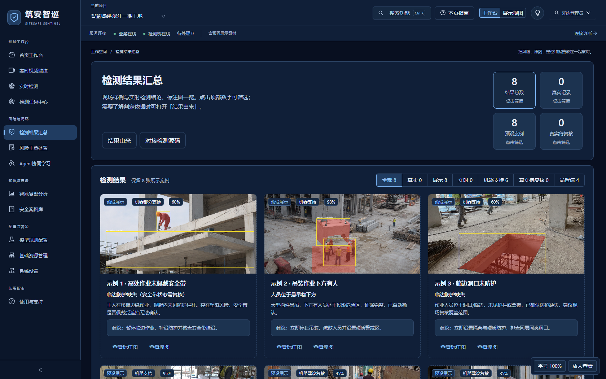

# 筑安智巡 · SiteSafe Sentinel

**面向开放施工风险的多模态安全监管智能体**

让安全员不仅看到告警，还能查看现场图像、定位证据和规范出处，并跟进整改与复验。

[下载 Windows 完整安装包 v1.5.3（x64）](https://github.com/Shrek2356/SiteSafe-Sentinel/releases/download/v1.5.3/SiteSafe-Sentinel_Setup_v1.5.3_x64.exe) · [发布说明与 SHA-256](https://github.com/Shrek2356/SiteSafe-Sentinel/releases/tag/v1.5.3) · [原项目仓库](https://github.com/Shrek2356/SiteSafe-Sentinel)

## 最终成果

- **分层巡检与开放风险识别**：YOLO26 负责实时初筛，施工领域适配的 Qwen 负责识别复杂隐患，如吊物下方有人、临边缺少防护。系统输出风险描述、可见证据和需要人工核实的疑点。
- **规范溯源与整改闭环**：RAG 检索规范，报告保留原文、章节、版本与引用快照。安全员确认后指派整改、收集反馈并复验销项。复盘可形成阈值调整提案，经管理员批准后生效。
- **桌面工作台**：支持交互三维工地、多项目切换、设备与组织管理，以及新设备部署引导。

| 评估项 | 结果 | 测试口径 |
|---|---:|---|
| 视觉检测 | TPR10 **84.3%** | 假阳性率为 10% 时的真阳性率；数据来自 5 个实际工地及公开数据集 |
| 实时初筛 | mAP50 **88.15%** | CSS 数据集上的目标检测指标，不是整条视觉检测链的准确率 |
| 深度思考查询 | **32.99 秒/张** | RTX 5060 Ti 16GB；YOLO26、Qwen3-VL-8B、SAM3 与 CLIP 组合实测 |

**模型交付**：团队已完成本地 Qwen 的施工领域 LoRA 指令微调。公开安装包 v1.5.3 不附带微调权重或适配器，也不会默认加载它们。

## 界面展示

**检测结果与图像证据**（内置展示案例）

黑白水墨主题与三维工地

安全知识库与规范核验

截图来自 PC 端 1.5.3 的演示环境。三维工地与摄像头点位为演示布局，截图不代表实时监控记录。

## 安装与授权

本仓库用于展示项目。完整 Windows 安装包（约 490 MiB）由原项目仓库的 Releases 提供。安装后可直接查看三维工地、双主题和八个预置案例；真实检测需另行配置模型权重与推理环境。升级前请退出旧版并备份工作空间。安装器未进行团队代码签名，请核对发布页的 SHA-256。

原项目仓库公开可见，但软件仍按原有授权条款提供。安装包不含模型权重；可下载不等于获准再分发或商用。

© 筑安智巡项目作者及贡献者。具体使用范围以安装包内的授权及第三方声明为准。
