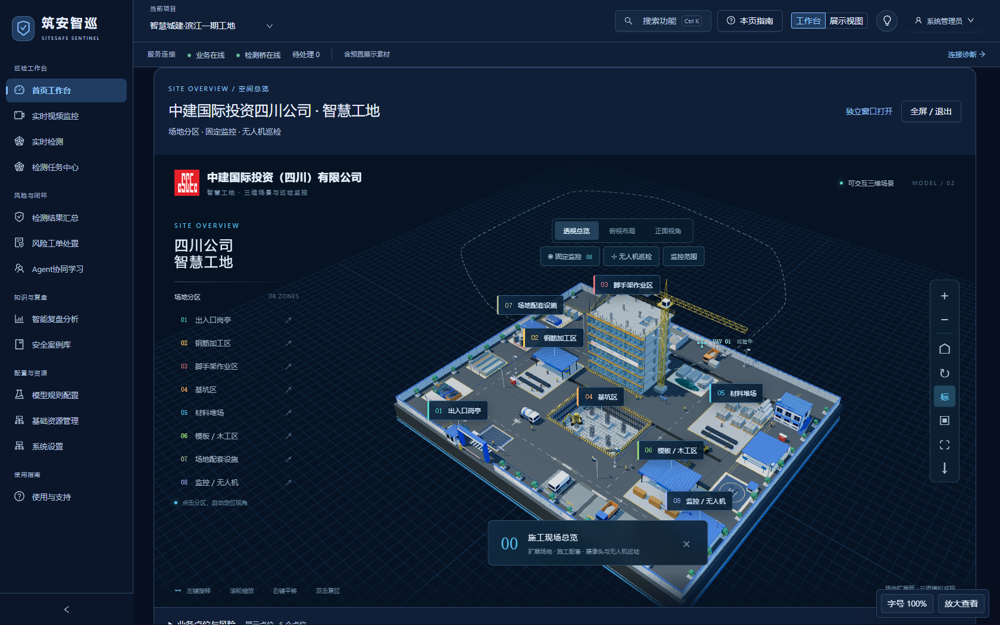
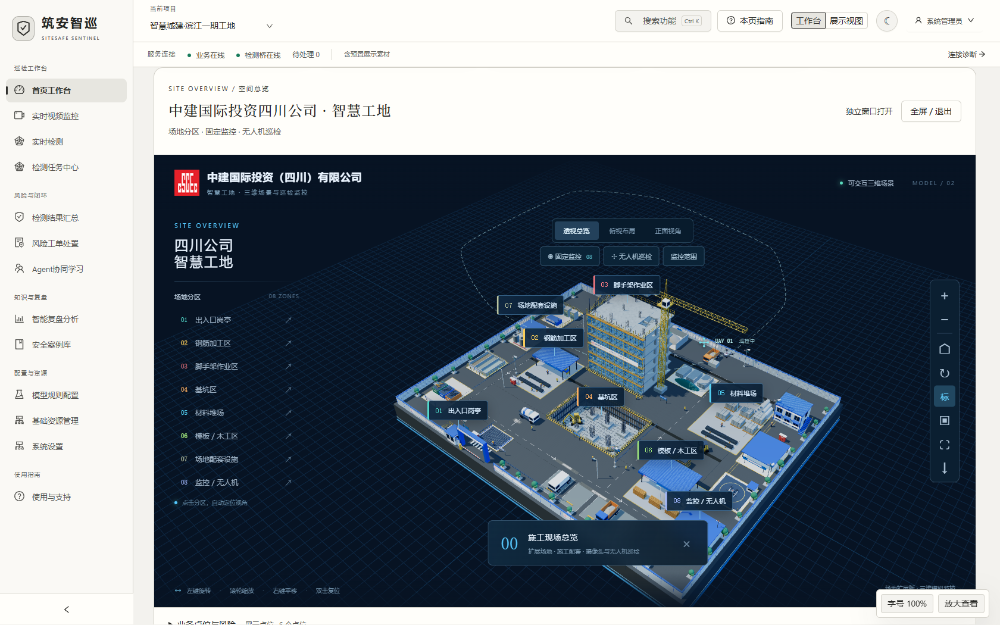
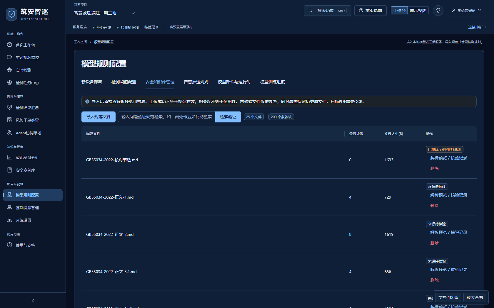

# 筑安智巡 · SiteSafe Sentinel

**面向开放施工风险的多模态安全监管智能体**

让安全员不仅看到告警，还能查看现场图像、定位证据和规范出处，并跟进整改与复验。

[下载 Windows 完整安装包 v1.5.3（x64）](https://github.com/Shrek2356/SiteSafe-Sentinel/releases/download/v1.5.3/SiteSafe-Sentinel_Setup_v1.5.3_x64.exe) · [发布说明与 SHA-256](https://github.com/Shrek2356/SiteSafe-Sentinel/releases/tag/v1.5.3) · [原项目仓库](https://github.com/Shrek2356/SiteSafe-Sentinel)

## 从巡检到整改

- **AIoT 视觉感知与分层调度**：摄像头画面先由 YOLO 初筛，再按需交给视觉语言模型分析；也支持图片直检和定期全图检查。
- **Open-Vocabulary 风险识别**：不只识别训练类别中的物体，也可发现「吊物下方有人」「临边缺少防护」等需要理解场景和空间关系的疑似风险。
- **图像证据与 RAG 规范溯源**：把视觉描述转为定位任务，组织检测框、掩码和风险描述；检索规范时保留出处，供安全员核查。
- **智能体协同处置**：辅助风险研判、整改派单、反馈与复验；复盘汇总确认与驳回记录，为后续规则调整提供依据。

**本地 Qwen 领域适配**：团队已完成面向工地安全风险识别的 LoRA 微调。微调权重与适配器暂不公开，不包含在 v1.5.3 安装包中。

## 界面展示

**检测结果与图像证据**（内置展示案例）

黑白水墨主题与三维工地

安全知识库与规范核验

截图来自 PC 端 1.5.3 的演示环境。三维工地与摄像头点位为演示布局，截图不代表实时监控记录。

## 安装与授权

本仓库用于展示项目。完整 Windows 安装包（约 490 MiB）由原项目仓库的 Releases 提供。安装后可直接查看三维工地、双主题和八个预置案例；真实检测需另行配置模型权重与推理环境。升级前请退出旧版并备份工作空间。安装器未进行团队代码签名，请核对发布页的 SHA-256。

原项目仓库公开可见，但软件仍按原有授权条款提供。安装包不含模型权重；可下载不等于获准再分发或商用。

© 筑安智巡项目作者及贡献者。具体使用范围以安装包内的授权及第三方声明为准。
